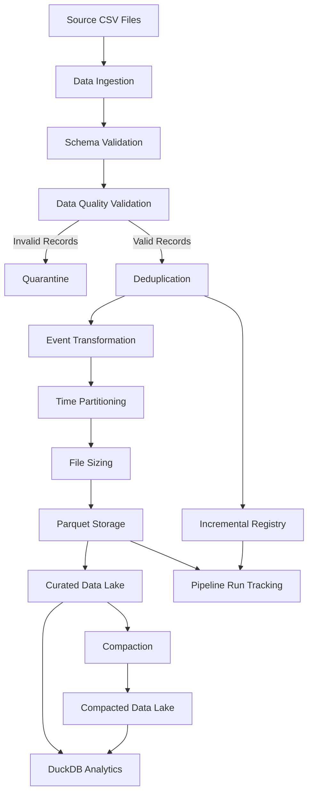
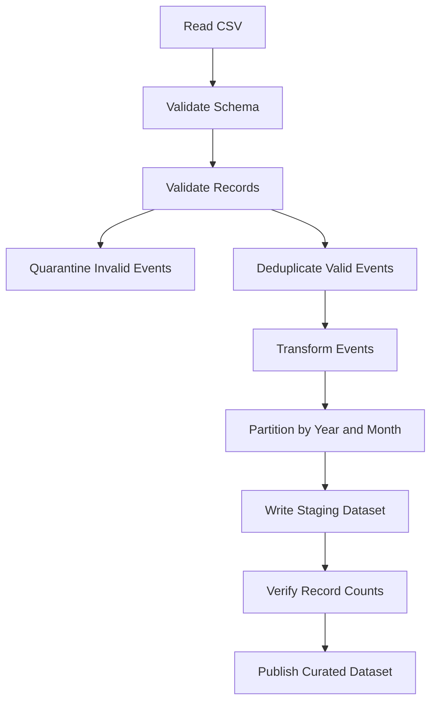
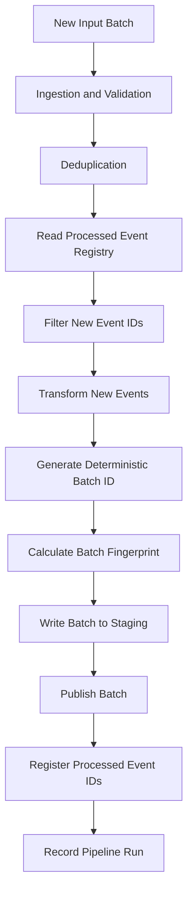

# TimeLake – System Architecture

## 1. Overview

TimeLake is a time-partitioned data lake prototype designed to demonstrate efficient storage, incremental processing, data quality enforcement, and analytical query performance.

The system uses Python, Pandas, Apache Parquet, PyArrow, DuckDB, and SQLite.

The architecture separates ingestion, validation, transformation, storage, metadata tracking, and analytical querying.

## 2. High-Level Architecture



## 3. Technology Stack

| Component | Technology | Responsibility |
|---|---|---|
| Programming language | Python | Pipeline implementation |
| Data processing | Pandas | DataFrame transformations |
| Columnar storage | Apache Parquet | Analytical data storage |
| Parquet engine | PyArrow | File writing and metadata inspection |
| Query engine | DuckDB | Analytical queries and pruning verification |
| Metadata storage | SQLite | Event registry and pipeline run history |
| Configuration | YAML | Pipeline settings |
| Testing | Pytest | Unit and regression testing |

## 4. Data Ingestion

The ingestion layer loads the source events and customer reference CSV files.

Responsibilities:
- Verify that input files exist.
- Reject empty input files.
- Validate required columns.
- Load source data into Pandas DataFrames.

The current implementation uses fixed input filenames:
- events.csv
- customers.csv

## 5. Data Validation

The validation layer checks incoming events against data quality rules.

Validation includes:
- Mandatory event and customer identifiers.
- Customer reference integrity.
- Timestamp validity.
- Supported event types.
- Numeric and non-negative transaction amounts.
- Zero-amount requirements for login and product_view events.

Invalid records are written to a quarantine dataset with rejection reasons.

Valid and rejected records are tracked separately.

## 6. Transformation and Deduplication

Before storage, valid events are deduplicated using event_id.

When duplicate events exist, the record with the earliest ingestion_timestamp is retained.

The transformation layer:
- Converts timestamps to UTC.
- Converts amount to numeric.
- Derives event_date.
- Derives year and month from event_timestamp.

Event time is the source of truth for partition assignment.

## 7. Partitioning Strategy

TimeLake uses monthly partitioning.

Partition hierarchy:

```text
lake/
└── curated/
    └── events/
        └── year=2026/
            ├── month=1/
            ├── month=2/
            ├── month=3/
            ├── month=4/
            ├── month=5/
            └── month=6/
```

### Why monthly partitioning?

Monthly partitions provide a balance between:
- Partition pruning for time-range queries.
- Avoiding excessive directory and metadata overhead.
- Keeping data grouped into manageable units.
- Supporting late-arriving events based on event time.

Queries filtering by year and month can eliminate irrelevant partitions before scanning Parquet data.

## 8. File Sizing Strategy

TimeLake uses byte-aware Parquet file sizing rather than relying only on fixed row counts.

Configured values:

| Parameter | Value |
|---|---:|
| Target file size | 128 MB |
| Minimum file size | 32 MB |
| Maximum file size | 256 MB |
| Compression | Snappy |

The algorithm:
1. Samples up to 1,000 rows.
2. Estimates compressed bytes per row.
3. Calculates an initial rows-per-file value.
4. Writes Parquet chunks.
5. Checks actual output size.
6. Recursively splits chunks exceeding the maximum size.

A single record larger than the maximum cannot be split further.

## 9. Full Refresh Processing

The full refresh pipeline processes the complete input dataset.



The storage process uses staging and backup directories.

The new dataset is written and verified before publication. If publication fails, the previous output is restored where possible.

## 10. Incremental Processing

Incremental processing avoids rewriting the entire dataset.

A SQLite registry tracks previously processed event IDs.

Processing flow:



### Idempotency

The batch ID is derived from sorted event IDs.

A separate SHA-256 fingerprint represents the normalized batch content.

When a previously published batch is submitted again:
- Matching IDs and matching content are treated as a successful retry.
- Matching IDs with changed content are rejected.
- Row ordering does not affect the fingerprint.

The SQLite registry is updated after successful Parquet publication.

If a failure occurs after publication but before registry registration, retrying the same batch detects the existing publication and avoids writing it again.

## 11. Compaction

Compaction combines smaller Parquet files within the same monthly partition.

The process:
1. Reads existing Parquet files.
2. Groups records by partition.
3. Rewrites data using the shared byte-aware sizing algorithm.
4. Verifies record counts.
5. Publishes the compacted dataset using staging and backup directories.

Compaction reduces file-management overhead and can improve query efficiency when many small files exist.

## 12. Query Processing and Partition Pruning

DuckDB is used to query Parquet datasets directly.

Example:

```sql
SELECT
    COUNT(*),
    SUM(amount)
FROM read_parquet(
    'lake/compacted/events/**/*.parquet',
    hive_partitioning = true
)
WHERE year = 2026
  AND month = 1;
```

DuckDB uses Hive-style partition information to eliminate irrelevant files.

### Benchmark Result

The 98,012-record benchmark produced six monthly Parquet files after compaction.

A January-only query demonstrated:

| Metric | Result |
|---|---:|
| Total monthly files | 6 |
| Files scanned | 1 |
| Files skipped | 5 |
| Matching events | 16,820 |
| Data read | 86.8 KB |

This demonstrates that monthly partitioning enables effective file pruning.

## 13. Observability

Pipeline runs are tracked in a separate SQLite database.

Each run records:
- Run ID.
- Pipeline type.
- Start and end timestamps.
- Success or failure status.
- Input, valid, rejected, duplicate, and output counts.
- Number of Parquet files.
- Error details.

This supports execution auditing and basic operational monitoring.

## 14. Recovery and Design Limitations

The prototype provides local filesystem staging, backup, rollback, and deterministic incremental retries.

Important limitations:
- Filesystem publication and SQLite registry updates are not one distributed transaction.
- Concurrent writers are not coordinated.
- Object-store transaction semantics are not implemented.
- Ingestion currently expects fixed CSV filenames.
- File sizing is based on a sample estimate, followed by actual-size verification.

These trade-offs are documented to distinguish the prototype's guarantees from production distributed data lake guarantees.

## 15. Future Improvements

Potential extensions include:
- Object-storage support.
- Distributed execution.
- Concurrent writer coordination.
- Schema evolution and versioned schemas.
- Automated compaction scheduling.
- Partition-level statistics and metadata manifests.
- More extensive performance tests at larger data volumes.